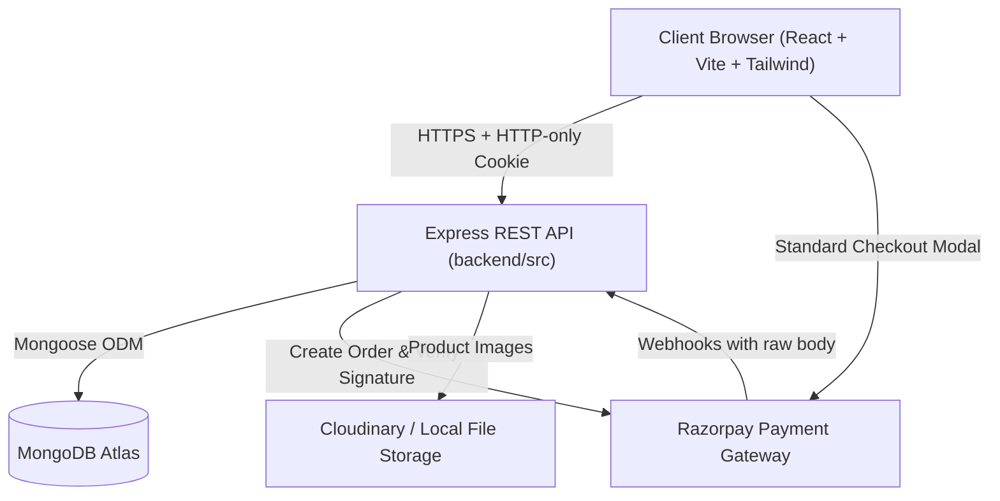
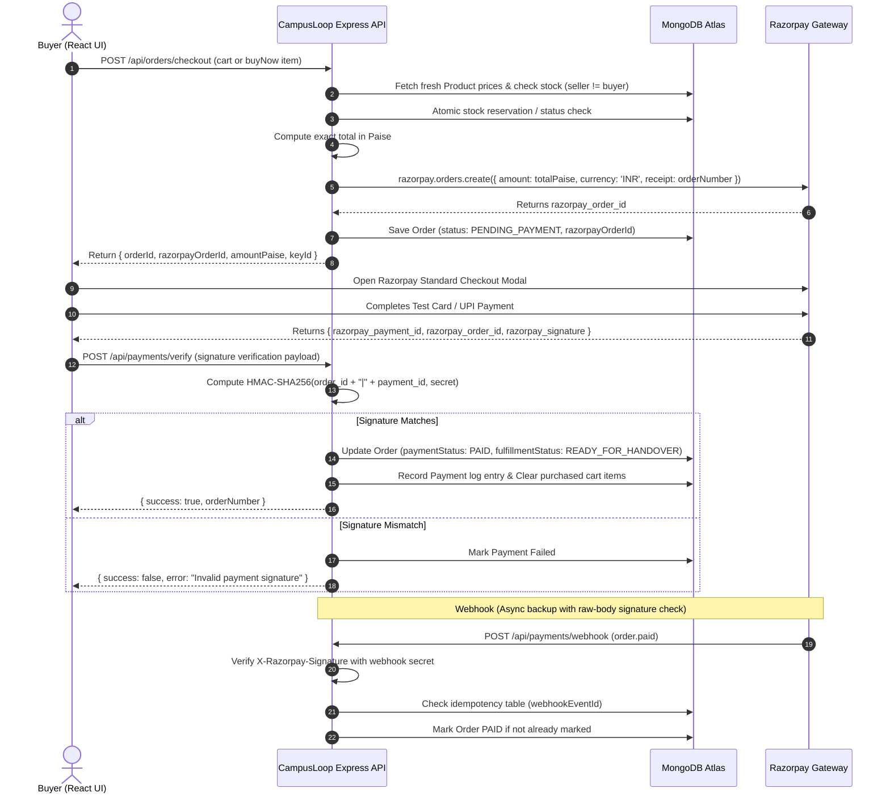

# CampusLoop — System Architecture Document

## 1. System Overview
CampusLoop is structured as a clean, modular monolith separated cleanly into two independent workspaces: `frontend/` (React SPA powered by Vite and Tailwind CSS) and `backend/` (Node.js + Express REST API backed by MongoDB Atlas with Mongoose).



---

## 2. Directory Structure

```
campusloop/
  docs/
    PRD.md
    ARCHITECTURE.md
    RULES.md
    DESIGN.md
    TASKS.md
    MEMORY.md
  frontend/
    src/
      assets/             # Static graphics, SVGs, placeholders
      components/         # Reusable atomic UI (Navbar, Footer, Card, Modal, Toast)
      context/            # AuthContext, CartContext, ToastContext
      hooks/              # Custom hooks (useAuth, useCart, useDebounce)
      layouts/            # MainLayout, AuthLayout, DashboardLayout
      pages/              # Public, Buyer, Seller, Admin route views
      services/           # Axios API clients (api.js, authService, productService)
      utils/              # Formatters (currency, date, condition badges)
      App.jsx             # Router definition and route guards
      main.jsx            # React root mount
      index.css           # Tailwind directives and design system tokens
    package.json
    vite.config.js
    tailwind.config.js
    postcss.config.js
    .env.example
  backend/
    src/
      config/             # Environment, DB connection, Razorpay, Cloudinary
      controllers/        # Route controllers (auth, products, cart, orders, etc.)
      middleware/         # authMiddleware, roleMiddleware, validate, errorHandler
      models/             # Mongoose schemas (User, Product, Cart, Order, etc.)
      routes/             # REST route declarations
      services/           # Business logic (orderService, paymentService, emailService)
      utils/              # Helpers (crypto, logger, constants)
      app.js              # Express app definition & middleware pipeline
      server.js           # Server bootstrap & DB connection
    tests/                # Automated test suites
    package.json
    .env.example
  .gitignore
  README.md
```

---

## 3. Database Architecture & Models

Monetary values are represented in **integer paise** (1 INR = 100 paise) across all backend calculations to eliminate floating point rounding errors.

### 3.1 User Model
```javascript
{
  name: { type: String, required: true, trim: true },
  email: { type: String, required: true, unique: true, lowercase: true, index: true },
  passwordHash: { type: String, required: true },
  role: { type: String, enum: ['BUYER', 'SELLER', 'ADMIN'], default: 'BUYER' },
  college: { type: String, required: true },
  phone: { type: String, default: '' },
  hostelRoom: { type: String, default: '' },
  isEmailVerified: { type: Boolean, default: false },
  emailVerificationToken: { type: String, default: null },
  emailVerificationExpires: { type: Date, default: null },
  status: { type: String, enum: ['ACTIVE', 'SUSPENDED'], default: 'ACTIVE' },
  timestamps: true
}
```

### 3.2 Product Model
```javascript
{
  title: { type: String, required: true, trim: true, index: 'text' },
  description: { type: String, required: true, trim: true },
  category: { 
    type: String, 
    required: true, 
    enum: ['Books', 'Electronics', 'Calculators', 'Cycles', 'Hostel Essentials', 'Lab Equipment', 'Other'],
    index: true 
  },
  priceInPaise: { type: Number, required: true, min: 0 },
  condition: { type: String, enum: ['New', 'Like New', 'Good', 'Fair'], required: true },
  images: [{ type: String }],
  isUniqueItem: { type: Boolean, default: true }, // unique single-unit used item
  stockQuantity: { type: Number, required: true, min: 0, default: 1 },
  sellerId: { type: mongoose.Schema.Types.ObjectId, ref: 'User', required: true, index: true },
  status: { type: String, enum: ['ACTIVE', 'RESERVED', 'SOLD', 'INACTIVE'], default: 'ACTIVE', index: true },
  pickupLocationNote: { type: String, default: 'On-campus meetup' },
  timestamps: true
}
```

### 3.3 Cart Model
```javascript
{
  userId: { type: mongoose.Schema.Types.ObjectId, ref: 'User', unique: true, index: true },
  items: [
    {
      productId: { type: mongoose.Schema.Types.ObjectId, ref: 'Product', required: true },
      quantity: { type: Number, required: true, min: 1, default: 1 },
      addedAt: { type: Date, default: Date.now }
    }
  ],
  updatedAt: { type: Date, default: Date.now }
}
```

### 3.4 Order Model
Order items are stored as immutable snapshots to maintain complete historic financial integrity even if the seller updates or removes the product later.
```javascript
{
  orderNumber: { type: String, required: true, unique: true, index: true },
  buyerId: { type: mongoose.Schema.Types.ObjectId, ref: 'User', required: true, index: true },
  items: [
    {
      productId: { type: mongoose.Schema.Types.ObjectId, ref: 'Product', required: true },
      sellerId: { type: mongoose.Schema.Types.ObjectId, ref: 'User', required: true },
      title: { type: String, required: true },
      priceInPaise: { type: Number, required: true },
      quantity: { type: Number, required: true, min: 1 },
      image: { type: String, default: '' }
    }
  ],
  totalAmountPaise: { type: Number, required: true },
  paymentStatus: { 
    type: String, 
    enum: ['PENDING_PAYMENT', 'PAID', 'PAYMENT_FAILED', 'REFUND_PENDING', 'REFUNDED'], 
    default: 'PENDING_PAYMENT',
    index: true
  },
  fulfillmentStatus: {
    type: String,
    enum: ['PROCESSING', 'READY_FOR_HANDOVER', 'COMPLETED', 'CANCELLED'],
    default: 'PROCESSING',
    index: true
  },
  razorpayOrderId: { type: String, default: null, index: true },
  razorpayPaymentId: { type: String, default: null },
  handoverLocation: { type: String, default: 'Campus Central Library / Student Center' },
  handoverNotes: { type: String, default: '' },
  timestamps: true
}
```

### 3.5 Payment & Webhook Log Model
```javascript
{
  razorpayOrderId: { type: String, required: true, index: true },
  razorpayPaymentId: { type: String, required: true, unique: true, index: true },
  orderId: { type: mongoose.Schema.Types.ObjectId, ref: 'Order', required: true },
  amountPaise: { type: Number, required: true },
  currency: { type: String, default: 'INR' },
  status: { type: String, required: true },
  signatureVerified: { type: Boolean, default: false },
  webhookEventId: { type: String, unique: true, sparse: true }, // idempotency key
  rawPayload: { type: Object },
  timestamps: true
}
```

### 3.6 Report Model
```javascript
{
  reporterId: { type: mongoose.Schema.Types.ObjectId, ref: 'User', required: true },
  reportedProductId: { type: mongoose.Schema.Types.ObjectId, ref: 'Product', required: true, index: true },
  reason: { 
    type: String, 
    enum: ['Suspicious listing', 'Misleading description', 'Duplicate listing', 'Prohibited item', 'Other'],
    required: true 
  },
  details: { type: String, required: true },
  status: { type: String, enum: ['OPEN', 'INVESTIGATING', 'RESOLVED', 'DISMISSED'], default: 'OPEN', index: true },
  adminNotes: { type: String, default: '' },
  timestamps: true
}
```

### 3.7 AuditLog Model
```javascript
{
  actorId: { type: mongoose.Schema.Types.ObjectId, ref: 'User', required: true },
  action: { type: String, required: true }, // e.g., 'DELIST_PRODUCT', 'SUSPEND_USER'
  targetType: { type: String, required: true }, // 'PRODUCT', 'USER', 'ORDER'
  targetId: { type: String, required: true },
  metadata: { type: Object, default: {} },
  ipAddress: { type: String },
  timestamps: true
}
```

---

## 4. End-to-End Payment & Checkout Flow



---

## 5. Inventory Concurrency & Race Condition Prevention
To prevent multiple buyers from purchasing the same unique item:
1. When checking out, an atomic conditional update is performed:
   ```javascript
   const product = await Product.findOneAndUpdate(
     { _id: item.productId, status: 'ACTIVE', stockQuantity: { $gte: item.quantity } },
     { $inc: { stockQuantity: -item.quantity } },
     { new: true }
   );
   ```
2. If `product` is null, the reservation fails gracefully and informs the buyer that the item has just been claimed.
3. If payment is cancelled or expires after 15 minutes, a rollback cron/worker restores the quantity.

---

## 6. Security Boundaries
1. **Never trust frontend amounts:** Prices, taxes, and fees are recalculated from the database during order creation.
2. **Secrets isolation:** Razorpay Secret and MongoDB URI reside solely on the backend `.env`.
3. **Session handling:** Stored in signed, HTTP-only, SameSite cookies.
4. **Ownership guards:** Middleware verifies `product.sellerId.toString() === req.user._id.toString()`.
5. **Admin verification:** Server-side `verifyRole(['ADMIN'])` checks token/session identity against the database, preventing spoofed role headers.
